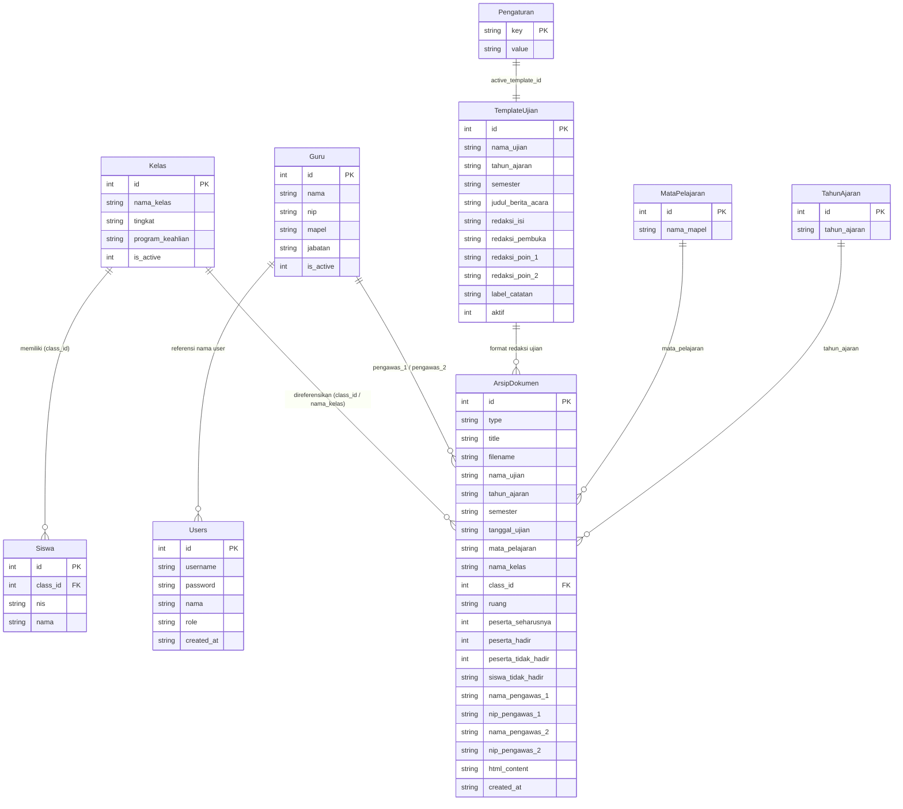

# SKEMA BASIS DATA GOOGLE SPREADSHEET (DATABASE SAS)

Dokumentasi rancangan relasional 9 Sheet/Tabel di Google Sheets untuk aplikasi **Generator Administrasi Ujian (Daftar Hadir & Berita Acara)** — **SMK NEGERI FYJ CHANNEL**.

---

## 🗄️ 1. Gambaran Umum Arsitektur

Google Spreadsheet difungsikan sebagai basis data relasional/NoSQL serverless:

- **Sheet sebagai Tabel**: Masing-masing sheet bertindak sebagai tabel independen.
- **Baris 1 sebagai Nama Kolom (Header)**.
- **Baris 2 ke Bawah sebagai Baris Data (Records)**.
- **Auto-Initialization**: Fungsi `setupSpreadsheetDatabase()` di [Code.gs](file:///d:/Downloads/Share-DKV%20F/COBA/ambil%20coba/Code.gs) otomatis membuat sheet yang belum ada, menyusun header, dan mengisi data awal (seeder 5 data contoh per master data) secara instan.
- **Universal Save Handler**: Fungsi `apiSaveDatabase(payload)` melayani penyimpanan atomik dan pembaruan massal (bulk sync) dari panel admin langsung ke Google Sheets.

---

## 📋 2. Rincian 9 Sheet Database

### 1. Sheet `Pengaturan`

Menyimpan konfigurasi identitas sekolah, logo, kop surat, semester, dan tahun ajaran aktif.

| Kolom | Tipe Data | Keterangan | Contoh Nilai |
| :--- | :--- | :--- | :--- |
| `key` | String (PK) | Kunci konfigurasi unik | `school_name` |
| `value` | String / JSON | Nilai konfigurasi / string base64 / JSON array | `SMK NEGERI FYJ CHANNEL` |

**Daftar Kunci Bawaan:**

- `school_name`: Nama resmi sekolah (`SMK NEGERI FYJ CHANNEL`).
- `school_tagline`: Tagline sekolah (`Generator Administrasi Ujian`).
- `school_logo`: String Data-URI Base64 logo resmi sekolah.
- `kop_header`: String Data-URI Base64 gambar kop surat resmi sekolah.
- `academic_year`: Tahun ajaran aktif (`2026/2027`).
- `default_semester`: Semester aktif (`Ganjil` / `Genap`).
- `timezone`: Zona waktu (`WITA`, `WIB`, atau `WIT`).
- `active_template_id`: ID template berita acara yang sedang aktif.
- `drive_folder_url`: URL folder Google Drive resmi untuk penyimpanan dan upload seluruh berkas SAS (`https://drive.google.com/drive/folders/19fGt2rXhNLL_N-vCLUXC_CmSiwi7UzGR`).
- `drive_folder_id`: ID unik folder Google Drive (`19fGt2rXhNLL_N-vCLUXC_CmSiwi7UzGR`), dapat disesuaikan sewaktu-waktu melalui Menu Pengaturan.

---

### 2. Sheet `Kelas`

Master daftar kelas resmi beserta program keahlian dan tingkat pendidikan.

| Kolom | Tipe Data | Keterangan |
| :--- | :--- | :--- |
| `id` | Integer (PK) | Auto-increment ID kelas |
| `nama_kelas` | String | Nama kelas resmi (contoh: `XII TKJ`, `XII DKV`) |
| `tingkat` | String | Tingkat kelas (`X`, `XI`, `XII`) |
| `program_keahlian` | String | Nama Program / Konsentrasi Keahlian |
| `is_active` | Integer | Status keaktifan kelas (`1` = Aktif, `0` = Nonaktif) |

---

### 3. Sheet `Siswa`

Master data peserta didik yang terdaftar per kelas.

| Kolom | Tipe Data | Keterangan |
| :--- | :--- | :--- |
| `id` | Integer (PK) | Auto-increment ID siswa |
| `class_id` | Integer (FK) | Relasi ke kolom `id` pada sheet `Kelas` |
| `nis` | String | Nomor Induk Siswa (NIS) |
| `nama` | String | Nama lengkap peserta didik |

---

### 4. Sheet `Guru`

Master data dewan guru dan pengawas ujian sekolah.

| Kolom | Tipe Data | Keterangan |
| :--- | :--- | :--- |
| `id` | Integer (PK) | Auto-increment ID guru |
| `nama` | String | Nama lengkap beserta gelar akademik |
| `nip` | String | Nomor Induk Pegawai (NIP) / NUPTK |
| `mapel` | String | Mata pelajaran utama yang diampu |
| `jabatan` | String | Peran / Jabatan (contoh: `Guru / Pengawas Ujian`) |
| `is_active` | Integer | Status aktif (`1` = Aktif) |

---

### 5. Sheet `MataPelajaran`

Daftar mata pelajaran resmi yang diujikan di sekolah.

| Kolom | Tipe Data | Keterangan |
| :--- | :--- | :--- |
| `id` | Integer (PK) | Auto-increment ID mapel |
| `nama_mapel` | String | Nama mata pelajaran resmi |

---

### 6. Sheet `TahunAjaran`

Daftar tahun ajaran akademik yang tersedia.

| Kolom | Tipe Data | Keterangan |
| :--- | :--- | :--- |
| `id` | Integer (PK) | Auto-increment ID tahun ajaran |
| `tahun_ajaran` | String | Periode tahun ajaran (contoh: `2026/2027`) |

---

### 7. Sheet `TemplateUjian`

Template redaksi format Berita Acara Ujian.

| Kolom | Tipe Data | Keterangan |
| :--- | :--- | :--- |
| `id` | Integer (PK) | ID template ujian |
| `nama_ujian` | String | Nama jenis ujian (contoh: `Sumatif Akhir Semester (SAS) Ganjil`) |
| `tahun_ajaran` | String | Periode tahun ajaran |
| `semester` | String | Semester (`Ganjil` / `Genap`) |
| `judul_berita_acara` | String | Judul dokumen berita acara |
| `redaksi_isi` | String (HTML) | Redaksi isi lengkap dengan chip variabel dinamis |
| `redaksi_pembuka` | String | Redaksi kalimat pembuka berita acara |
| `redaksi_poin_1` | String | Redaksi butir rekap peserta hadir/tidak hadir |
| `redaksi_poin_2` | String | Redaksi butir catatan khusus pelaksanaan ujian |
| `label_catatan` | String | Label catatan kejadian khusus |
| `aktif` | Integer | Status template aktif (`1` = Aktif, `0` = Tidak) |

---

### 8. Sheet `ArsipDokumen`

Penyimpanan riwayat dokumen yang telah dicetak atau diunduh sebagai PDF resmi.

| Kolom | Tipe Data | Keterangan |
| :--- | :--- | :--- |
| `id` | Integer (PK) | Timestamp unik berkas arsip (contoh: `1730000000000`) |
| `type` | String | Jenis dokumen (`daftar_hadir` atau `berita_acara`) |
| `title` | String | Judul dokumen |
| `filename` | String | Nama berkas saat diunduh (contoh: `Daftar_Hadir_XII_DKV.pdf`) |
| `nama_ujian` | String | Nama ujian saat dokumen dibuat |
| `tahun_ajaran` | String | Tahun ajaran dokumen |
| `semester` | String | Semester |
| `tanggal_ujian` | String | Tanggal pelaksanaan ujian (`YYYY-MM-DD`) |
| `mata_pelajaran` | String | Mata pelajaran yang diujikan |
| `nama_kelas` | String | Nama kelas |
| `class_id` | Integer | ID kelas |
| `ruang` | String | Ruang ujian |
| `peserta_seharusnya` | Integer | Jumlah peserta seharusnya |
| `peserta_hadir` | Integer | Jumlah peserta hadir |
| `peserta_tidak_hadir` | Integer | Jumlah peserta tidak hadir |
| `siswa_tidak_hadir` | String | Daftar nama dan status siswa tidak hadir |
| `nama_pengawas_1` | String | Nama pengawas I |
| `nip_pengawas_1` | String | NIP pengawas I |
| `nama_pengawas_2` | String | Nama pengawas II |
| `nip_pengawas_2` | String | NIP pengawas II |
| `html_content` | String (HTML) | Salinan HTML dokumen A4 untuk cetak ulang instan |
| `created_at` | String (ISO) | Waktu pengarsipan |

---

### 9. Sheet `Users`

Akun pengguna yang memiliki otorisasi masuk ke Panel Administrator.

| Kolom | Tipe Data | Keterangan |
| :--- | :--- | :--- |
| `id` | Integer (PK) | ID pengguna |
| `username` | String (Unique) | Nama pengguna untuk login |
| `password` | String | Kata sandi pengguna |
| `nama` | String | Nama lengkap pengguna |
| `role` | String | Hak akses: `admin` (Super Admin) atau `operator` |
| `created_at` | String (ISO) | Tanggal pembuatan akun |

---

## 🔄 3. Integritas Data & Mekanisme Sinkronisasi

1. **Sinkronisasi Atomik (`apiSaveDatabase`)**:
   Setiap perubahan pada tabel data (tambah/edit/hapus/impor massal) dikirimkan melalui fungsi universal `apiSaveDatabase(payload)` di [Code.gs](file:///d:/Downloads/Share-DKV%20F/COBA/ambil%20coba/Code.gs) yang mengeksekusi operasi `batchReplaceTable` secara cepat dan aman di Google Sheets.
2. **Auto-Register Kelas Baru**:
   Saat menginput data siswa manual atau impor Excel, jika nama kelas belum ada di tabel `Kelas`, sistem otomatis mendaftarkannya ke sheet `Kelas` dengan tingkat dan program keahlian yang terdeteksi otomatis.
3. **Cascade Update Relasi Kelas**:
   Perubahan nama kelas pada Master Kelas otomatis memperbarui data siswa terkait dan dokumen arsip yang bersesuaian di sheet `ArsipDokumen`.
4. **Smart Delete Linked Archive**:
   Saat menghapus dokumen Daftar Hadir, sistem melacak apakah terdapat dokumen Berita Acara yang dibuat pada tanggal, mapel, dan kelas yang sama persis, lalu memberikan opsi pembersihan berkas terkait secara serempak.
5. **Role-Based Access Control (RBAC)**:
   Pengguna dengan role `operator` secara otomatis dibatasi dari akses ke menu `Users` dan `Database`, baik melalui navigasi sidebar maupun routing langsung URL.
