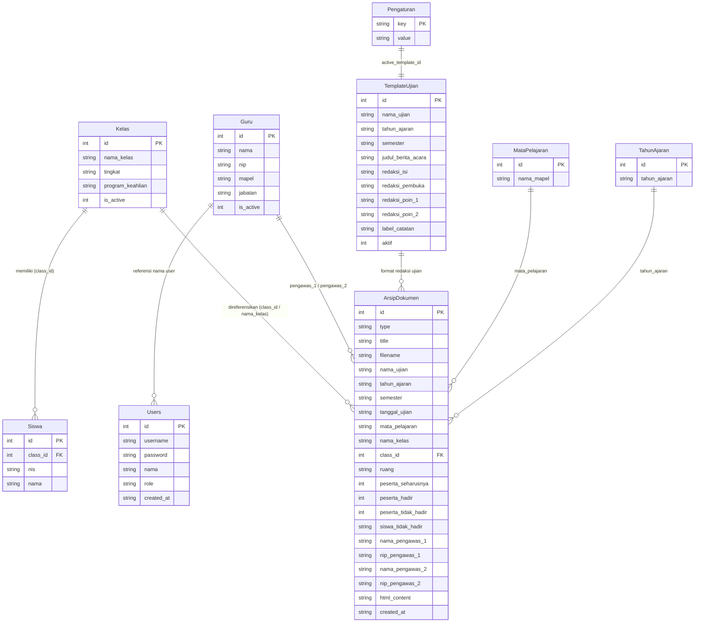

# SKEMA BASIS DATA GOOGLE SPREADSHEET (DATABASE SAS)

Dokumentasi rancangan relasional 9 Sheet/Tabel di Google Sheets untuk aplikasi **Generator Administrasi Ujian (Daftar Hadir & Berita Acara)** — **SMK NEGERI FYJ CHANNEL**.

---

## 🗄️ 1. Gambaran Umum Arsitektur Basis Data

Google Spreadsheet difungsikan sebagai basis data relasional serverless:

- **Sheet sebagai Tabel**: Masing-masing sheet bertindak sebagai tabel data independen.
- **Baris 1 sebagai Nama Kolom (Header)**.
- **Baris 2 ke Bawah sebagai Baris Data (Records)**.
- **Auto-Initialization**: Fungsi `setupSpreadsheetDatabase()` dan `jalankanIsiDataAwal()` di [Code.gs](file:///d:/Downloads/Share-DKV%20F/COBA/ambil%20coba/Code.gs) otomatis membuat sheet yang belum ada, menyusun header tebal, membekukan baris pertama (*frozen header*), dan mengisi data awal (*seeder*) secara instan.
- **Lapis Akses Cepat (*High-Speed Caching Layer*)**:
  - `CacheService.getScriptCache()`: Menyimpan cache memori tabel per-sheet selama 30 menit untuk waktu baca **< 10 milidetik**.
  - `_requestTableCache`: Mencegah pembacaan berulang dalam 1 siklus eksekusi Apps Script.
  - `apiGetInitialData()`: Menyatukan pembacaan 9 entitas menjadi **1 kali round-trip**, mengeliminasi *network waterfall delay*.
- **Universal Save Handler**: Fungsi `apiSaveDatabase(payload)` melayani penyimpanan atomik dan pembaruan massal (*bulk sync*) langsung ke Google Sheets dengan proteksi tabel agar tidak terhapus secara tidak sengaja.

---

## 📋 2. Rincian 9 Sheet Database

### 1. Sheet `Pengaturan`

Menyimpan konfigurasi identitas sekolah, logo, kop surat, semester, master tahun ajaran, dan folder Google Drive Arsip.

| Kolom | Tipe Data | Keterangan | Contoh Nilai |
| :--- | :--- | :--- | :--- |
| `setting_key` / `key` | String (PK) | Kunci konfigurasi unik (fleksibel mendukung kedua format) | `nama_sekolah` / `school_name` |
| `setting_value` / `value` | String / JSON | Nilai konfigurasi / URL thumbnail Google Drive / JSON array | `SMK NEGERI FYJ CHANNEL` |

**Daftar Kunci Bawaan (Diselaraskan Runtut Sesuai Menu Pengaturan & Terseeder Otomatis):**

1. **Seksi Kop Surat Resmi A4**:
   - `kop_mode`: Mode kop dokumen (`image` untuk banner lengkap, atau `text` untuk mode teks & logo terpisah).
   - `kop_header` / `kop_image_path`: URL Gambar Thumbnail Google Drive banner resmi kop surat A4 (`https://drive.google.com/thumbnail?id=1QXtnYwIrCc-pihDUoidjkRW5UVWykOn-&sz=w1600`).
   - `kop_baris_1`: `PEMERINTAH PROVINSI FYJ`
   - `kop_baris_2`: `DINAS PENDIDIKAN KEPEMUDAAN DAN OLAHRAGA`
   - `kop_baris_3`: `SMK NEGERI FYJ CHANNEL`
   - `kop_telepon`: Kontak telepon dan email sekolah (`Telp. (0300) 2002 | Email: smkn@yahoo.com`).
   - `kop_website`: Alamat website resmi sekolah (`Website: smkn.sch.id`).

2. **Seksi Logo Sekolah**:
   - `school_logo` / `logo_path`: URL Gambar Thumbnail Google Drive logo resmi sekolah (`https://drive.google.com/thumbnail?id=1GUfUommgYjV-cnhU0tTB8kRJy8iXagkI&sz=w1600`).

3. **Seksi Identitas Sekolah & Penyimpanan Google Drive**:
   - `nama_sekolah` / `school_name`: Nama resmi sekolah (`SMK NEGERI FYJ CHANNEL`).
   - `alamat_sekolah`: Alamat lengkap sekolah (`Jl. Merpati No. 1`).
   - `google_drive_folder_url` / `drive_folder_url`: URL folder Google Drive resmi untuk penyimpanan Arsip SAS (`https://drive.google.com/drive/folders/19fGt2rXhNLL_N-vCLUXC_CmSiwi7UzGR`).
   - `google_drive_folder_id` / `drive_folder_id`: ID unik folder Google Drive arsip.

4. **Seksi Master Tahun Ajaran & Semester**:
   - `tahun_ajaran_aktif` / `academic_year`: Tahun ajaran aktif (`2026/2027`).
   - `semester_aktif` / `default_semester`: Semester aktif (`Ganjil` / `Genap`).
   - `daftar_tahun_ajaran`: JSON string array daftar master tahun ajaran (contoh: `["2024/2025","2025/2026","2026/2027","2027/2028"]`).

5. **Seksi Pejabat Penandatangan Dokumen Resmi**:
   - `kepala_sekolah`: Nama Kepala Sekolah (`Drs. I Ketut Suardana, M.Pd.`).
   - `nip_kepala_sekolah`: NIP Kepala Sekolah (`19680315 199412 1 002`).
   - `tempat_cetak`: Kota tempat penerbitan dokumen (`Denpasar`).
   - `format_tanggal_cetak`: Pola format tanggal cetak (`d MMMM yyyy`).

> [!TIP]
> **Mekanisme Auto-Seeding**: Jika sheet `Pengaturan` kosong atau baru dibuat, sistem secara otomatis mengisi seluruh baris default di atas begitu Web App pertama kali diakses atau melalui tombol *"Terapkan Nilai Default Resmi"* di UI.

> [!NOTE]
> **Metode Pembaruan Aset Logo & Kop**:
> - **Cara 1 (Link URL)**: Pengguna dapat menempelkan URL gambar langsung atau tautan berbagi Google Drive. Sistem secara otomatis mengonversinya menjadi URL thumbnail publik resolusi tinggi (`sz=w1600`).
> - **Cara 2 (Upload File ke Drive)**: File diunggah langsung ke Folder Google Drive Arsip melalui `DriveApp`, diset hak akses lihat publik via tautan, dan langsung menggantikan URL sebelumnya di sheet `Pengaturan`.

---

### 2. Sheet `Kelas`

Master daftar kelas resmi beserta program keahlian dan tingkat pendidikan.

| Kolom | Tipe Data | Keterangan |
| :--- | :--- | :--- |
| `id` | Integer (PK) | Auto-increment ID kelas |
| `nama_kelas` | String | Nama kelas resmi (contoh: `XII TKJ`, `XII DKV`) |
| `tingkat` | String | Tingkat kelas (`X`, `XI`, `XII`) |
| `program_keahlian` | String | Nama Program / Konsentrasi Keahlian |
| `is_active` | Integer | Status keaktifan kelas (`1` = Aktif, `0` = Nonaktif) |

---

### 3. Sheet `Siswa`

Master data peserta didik yang terdaftar per kelas.

| Kolom | Tipe Data | Keterangan |
| :--- | :--- | :--- |
| `id` | Integer (PK) | Auto-increment ID siswa |
| `class_id` | Integer (FK) | Relasi ke kolom `id` pada sheet `Kelas` |
| `nis` | String | Nomor Induk Siswa (NIS) |
| `nama` | String | Nama lengkap peserta didik |

---

### 4. Sheet `Guru`

Master data dewan guru dan pengawas ujian sekolah.

| Kolom | Tipe Data | Keterangan |
| :--- | :--- | :--- |
| `id` | Integer (PK) | Auto-increment ID guru |
| `nama` | String | Nama lengkap beserta gelar akademik |
| `nip` | String | Nomor Induk Pegawai (NIP) / NUPTK |
| `mapel` | String | Mata pelajaran utama yang diampu |
| `jabatan` | String | Peran / Jabatan (contoh: `Guru / Pengawas Ujian`) |
| `is_active` | Integer | Status aktif (`1` = Aktif) |

---

### 5. Sheet `MataPelajaran`

Daftar mata pelajaran resmi yang diujikan di sekolah. Dikelola melalui **Textarea** di menu Pengaturan Sekolah (satu baris untuk setiap mapel).

| Kolom | Tipe Data | Keterangan |
| :--- | :--- | :--- |
| `id` | Integer (PK) | Auto-increment ID mapel |
| `nama_mapel` | String | Nama mata pelajaran resmi |

---

### 6. Sheet `TahunAjaran`

Daftar tahun ajaran akademik yang tersedia. Dikelola melalui **Textarea** di menu Pengaturan Sekolah (satu baris untuk setiap tahun, contoh: `2026/2027`).

| Kolom | Tipe Data | Keterangan |
| :--- | :--- | :--- |
| `id` | Integer (PK) | Auto-increment ID tahun ajaran |
| `tahun_ajaran` | String | Periode tahun ajaran (contoh: `2026/2027`) |

---

### 7. Sheet `TemplateUjian`

Template redaksi format Berita Acara Ujian.

| Kolom | Tipe Data | Keterangan |
| :--- | :--- | :--- |
| `id` | Integer (PK) | ID template ujian |
| `nama_ujian` | String | Nama jenis ujian (contoh: `Sumatif Akhir Semester (SAS) Ganjil`) |
| `tahun_ajaran` | String | Periode tahun ajaran |
| `semester` | String | Semester (`Ganjil` / `Genap`) |
| `judul_berita_acara` | String | Judul dokumen berita acara |
| `redaksi_isi` | String (HTML) | Redaksi isi lengkap dengan chip variabel dinamis |
| `redaksi_pembuka` | String | Redaksi kalimat pembuka berita acara |
| `redaksi_poin_1` | String | Redaksi butir rekap peserta hadir/tidak hadir |
| `redaksi_poin_2` | String | Redaksi butir catatan khusus pelaksanaan ujian |
| `label_catatan` | String | Label catatan kejadian khusus |
| `aktif` | Integer | Status template aktif (`1` = Aktif, `0` = Tidak) |

---

### 8. Sheet `ArsipDokumen`

Penyimpanan riwayat dokumen yang telah dicetak atau diunduh sebagai PDF resmi.

| Kolom | Tipe Data | Keterangan |
| :--- | :--- | :--- |
| `id` | Integer (PK) | Timestamp unik berkas arsip |
| `type` | String | Jenis dokumen (`daftar_hadir` atau `berita_acara`) |
| `title` | String | Judul dokumen |
| `filename` | String | Nama berkas saat diunduh (contoh: `Daftar_Hadir_XII_DKV.pdf`) |
| `nama_ujian` | String | Nama ujian saat dokumen dibuat |
| `tahun_ajaran` | String | Tahun ajaran dokumen |
| `semester` | String | Semester |
| `tanggal_ujian` | String | Tanggal pelaksanaan ujian (`YYYY-MM-DD`) |
| `mata_pelajaran` | String | Mata pelajaran yang diujikan |
| `nama_kelas` | String | Nama kelas |
| `class_id` | Integer | ID kelas |
| `ruang` | String | Ruang ujian |
| `peserta_seharusnya` | Integer | Jumlah peserta seharusnya |
| `peserta_hadir` | Integer | Jumlah peserta hadir |
| `peserta_tidak_hadir` | Integer | Jumlah peserta tidak hadir |
| `siswa_tidak_hadir` | String | Daftar nama dan status siswa tidak hadir |
| `nama_pengawas_1` | String | Nama pengawas I |
| `nip_pengawas_1` | String | NIP pengawas I |
| `nama_pengawas_2` | String | Nama pengawas II |
| `nip_pengawas_2` | String | NIP pengawas II |
| `html_content` | String (HTML) | Salinan HTML dokumen A4 untuk cetak ulang instan |
| `created_at` | String (ISO) | Waktu pengarsipan |

---

### 9. Sheet `Users`

Akun pengguna yang memiliki otorisasi masuk ke Panel Administrator.

| Kolom | Tipe Data | Keterangan |
| :--- | :--- | :--- |
| `id` | Integer (PK) | ID pengguna |
| `username` | String (Unique) | Nama pengguna untuk login |
| `password` | String | Kata sandi pengguna |
| `nama` | String | Nama lengkap pengguna |
| `role` | String | Hak akses: `admin` (Super Admin) atau `operator` |
| `created_at` | String (ISO) | Tanggal pembuatan akun |

---

## 🔄 3. Integritas Data & Mekanisme Sinkronisasi

1. **Sinkronisasi Atomik & Proteksi Data (`apiSaveDatabase`)**:
   Operasi simpan dari formulir diproteksi agar array kosong tidak secara tidak sengaja mengosongkan tabel `Siswa` atau `Guru`. Penghapusan massal hanya dieksekusi jika flag khusus seperti `delete_all_students: true` dikirimkan secara eksplisit.
2. **Auto-Register Kelas Baru**:
   Saat menginput siswa baru atau impor Excel, kelas baru yang belum ada akan otomatis dibuatkan baris di sheet `Kelas`.
3. **Smart Delete Linked Archive**:
   Saat menghapus arsip ujian dari `AdminArsip`, server secara cerdas mengidentifikasi berkas kembaran (Daftar Hadir dan Berita Acara pada tanggal, mapel, dan kelas yang sama) dan menghapus keduanya sekaligus, serta mengembalikan `deleted_ids` ke antarmuka pengguna untuk pembaruan tampilan instan.
4. **Role-Based Access Control (RBAC)**:
   Akses ke menu `Users` dan `Database` dibatasi hanya untuk role `admin`.
