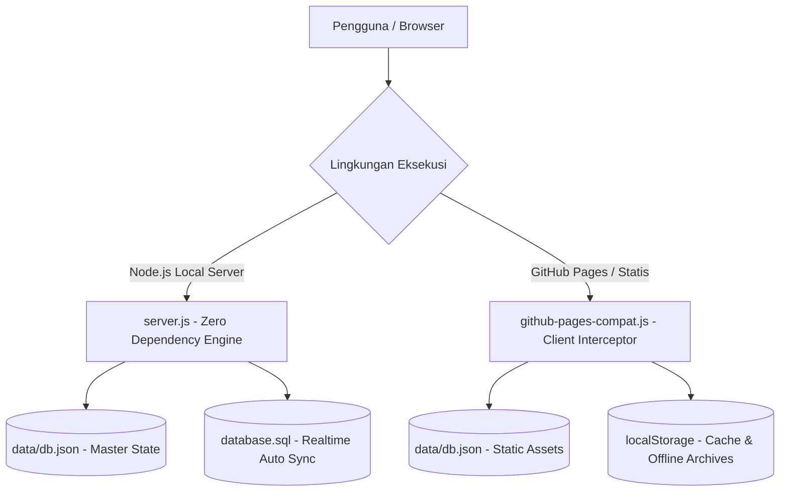

# DOKUMENTASI TEKNIK PEMBUATAN & ARSITEKTUR SISTEM
## SISTEM GENERATOR ADMINISTRASI UJIAN (ABSENSI & BERITA ACARA)
### SMK NEGERI 1 KLUNGKUNG

---

## 1. PENDAHULUAN & LATAR BELAKANG
Aplikasi ini dikembangkan untuk mendigitalkan, mempercepat, dan membakukan proses pembuatan dokumen administrasi Sumatif Akhir Semester (SAS) di **SMK Negeri 1 Klungkung**. Dokumen utama yang dihasilkan adalah:
1. **Daftar Hadir Peserta Ujian** (Lengkap dengan NIS, nomor urut, status kehadiran Hadir/Sakit/Izin/Alfa, serta tanda tangan pengawas).
2. **Berita Acara Penyelenggaraan Ujian** (Redaksi resmi terstandarisasi, rekap kehadiran otomatis tersinkron dari daftar hadir, catatan kendala, dan tanda tangan pengawas ujian).
3. **Arsip Dokumen Ujian** (Penyimpanan terpusat dokumen hasil cetak/unduh dengan riwayat lengkap, pencarian instan, dan 5 filter seleksi detail).

---

## 2. ARSITEKTUR SISTEM (DUAL ENVIRONMENT)
Sistem dirancang dengan arsitektur **Hybrid Zero-Dependency**:
1. **Mode Server Lokal / Intranet (Node.js Zero-Dependency)**:
   - Berjalan pada runtime Node.js bawaan tanpa memerlukan `node_modules` atau package manager eksternal.
   - Menggunakan modul inti: `http`, `fs`, `path`, `url`.
   - Menggunakan arsitektur REST API mandiri dan sinkronisasi realtime ke basis data relasional MySQL/MariaDB (`database.sql`).
2. **Mode Hosting Statis & GitHub Pages (Client-Side Interceptor)**:
   - Berkat file `assets/js/github-pages-compat.js`, seluruh sistem dapat dijalankan langsung di server hosting statis murni seperti **GitHub Pages** tanpa server Node.js.
   - Script kompatibilitas mencegat seluruh panggilan `/api/*` secara transparan dan mengalihkannya ke cache browser (`localStorage`) dan file master data statis `data/db.json`.



---

## 3. PEMISAHAN PANEL ADMINISTRATOR (MODULAR PER MENU)
Panel Administrator telah dipisahkan menjadi halaman HTML penuh independen (`1 Menu = 1 Full HTML Terkoneksi`), menghilangkan potensi kegagalan JS monolitik dan memungkinkan navigasi URL standar:

| Halaman | Lokasi Berkas | Deskripsi & Fungsi Utama |
|---|---|---|
| **Dashboard** | `public/admin/index.html` | Ringkasan statistik, status database, pintasan menu cepat. |
| **Siswa & Kelas** | `public/admin/siswa.html` | Master 11 kelas, 258 siswa, filter kelas, export/import Excel (.xlsx), tambah/edit/hapus siswa, hapus massal per kelas atau hapus semua data siswa. |
| **Guru & Pengawas** | `public/admin/guru.html` | Master dewan guru & pengawas ujian, export/import Excel (.xlsx), autocomplete nama dan otomatisasi pengisian NIP. |
| **Template Ujian** | `public/admin/template.html` | Redaksi HTML berita acara, variabel dinamis (`[semester]`, `[tahun_ajaran]`, `[tanggal]`, dll.), riwayat template, pratinjau live. |
| **Arsip Dokumen** | `public/admin/arsip.html` | Manajemen berkas ujian tersimpan dengan 5 filter seleksi detail, tinjau ulang berkas, unduh PDF, dan hapus berkas. |
| **Pengaturan & Kop** | `public/admin/pengaturan.html` | Identitas sekolah, dropdown tahun ajaran aktif dinamis, master mata pelajaran resmi, master daftar tahun ajaran, dan upload/reset kop surat resmi. |
| **Manajemen User** | `public/admin/users.html` | Kelola akun administrator & operator ujian, pengaturan kata sandi dengan toggle mata, proteksi akun utama. |
| **Database & Backup** | `public/admin/database.html` | Unduh langsung `database.sql`, `db.json`, `Data_Siswa.xlsx`, dan metrik kapasitas basis data. |
| **Login Administrator** | `public/admin/login.html` | Halaman login dengan tombol toggle mata pada kolom password, proteksi sesi (`sas_admin_auth`), dan multi-user authentication. |

---

## 4. STRUKTUR DIREKTORI PROYEK

```text
web-sas-dh-n-beritaacara/
├── index.html                   # Entry point root (auto-forwarding untuk GitHub Pages)
├── server.js                    # Web server HTTP mandiri Node.js (Zero Dependency)
├── database.sql                 # Skema DDL & DML MySQL/MariaDB (Auto-synchronized)
├── README.md                    # Panduan ringkas penggunaan sistem
├── Teknik pembuata.md           # Dokumentasi arsitektur, teknik, & alur pembuatan
├── package.json                 # Metadata proyek & skrip npm
├── data/
│   └── db.json                  # Basis data JSON utama (Master source of truth)
└── public/
    ├── index.html               # Beranda publik SMK Negeri 1 Klungkung
    ├── absensi.html             # Generator Daftar Hadir Ujian
    ├── berita-acara.html        # Generator Berita Acara Ujian
    ├── arsip.html               # Arsip Dokumen Publik (5 Filter Detail)
    ├── admin/                   # Modul Panel Administrator Terpisah
    │   ├── index.html           # Dashboard Admin
    │   ├── siswa.html           # Master Siswa & Kelas
    │   ├── guru.html            # Master Guru & Pengawas
    │   ├── template.html        # Template Ujian & Redaksi
    │   ├── arsip.html           # Arsip Dokumen Admin
    │   ├── pengaturan.html      # Pengaturan Sekolah, Mapel, Tahun, & Kop
    │   ├── users.html           # Manajemen Akun User & Hak Akses
    │   ├── database.html        # Backup & Ekspor Basis Data
    │   └── login.html           # Login Admin (Password Eye Toggle)
    └── assets/
        ├── css/
        │   ├── app.css          # Desain sistem responsif & komponen UI
        │   └── preview-a4.css   # Styling cetak A4 presisi (Tanpa underline & tanda kurung pengawas)
        ├── js/
        │   ├── absensi.js       # Logika formulir & live preview absensi
        │   ├── berita-acara.js  # Logika formulir & live preview berita acara
        │   ├── admin-common.js  # Auth check, loader, sidebar active state, & toast helper
        │   ├── github-pages-compat.js # Client-side interceptor API untuk GitHub Pages
        │   ├── html2pdf.bundle.min.js # Kompilasi PDF berbasis canvas A4
        │   └── xlsx.full.min.js # SheetJS offline untuk export/import Excel
        └── img/
            ├── logo.png         # Logo resmi SMK Negeri 1 Klungkung
            ├── kop-header.png   # Kop surat aktif
            └── kop-default.png  # Cadangan kop surat bawaan pabrik
```

---

## 5. MEKANISME BASIS DATA & SINKRONISASI OTOMATIS
1. **JSON Primary Source of Truth (`data/db.json`)**:
   - Seluruh mutasi data (penambahan siswa, perubahan guru, update template, penggantian kop, penambahan user, dan penyimpanan arsip) diperbarui secara instan pada file `data/db.json`.
2. **Realtime SQL Synchronizer (`syncSqlFile`)**:
   - Fungsi `syncSqlFile(db)` di dalam `server.js` merekonstruksi seluruh skema relasional tabel MySQL/MariaDB:
     - `classes`
     - `students`
     - `teachers`
     - `exam_templates`
     - `settings`
     - `users`
     - `exam_archives`
   - Setiap kali terjadi perubahan pada REST API (POST `/api/save-db`, POST `/api/save-user`, POST `/api/save-archive`, dll.), file `database.sql` ditulis ulang secara otomatis. Dengan demikian, file `database.sql` selalu 100% mutakhir dan siap diimpor ke phpMyAdmin/MySQL server produksi.

---

## 6. MEKANISME GENERATOR DOKUMEN & LIVE PREVIEW A4
1. **Live Synchronous Preview**:
   - Input formulir di sisi kiri langsung diikat (*two-way binding*) ke lembar kerja A4 di sisi kanan secara real-time.
2. **Format Tanda Tangan Pengawas Resmi**:
   - Sesuai standarisasi dokumen resmi, tanda tangan pengawas ujian disajikan bersih **tanpa tanda kurung `()`** dan **tanpa garis bawah (`underline`)**.
3. **Penyimpanan Berkas Otomatis**:
   - Ketika pengguna menekan tombol **"Unduh PDF"** atau **"Cetak Dokumen"**, konten HTML utuh dan metadata dokumen otomatis dikirim ke backend `/api/save-archive`.
   - Dokumen langsung tercatat pada menu **Arsip Dokumen** untuk dibuka dan dicetak kembali sewaktu-waktu.

---

## 7. FITUR FILTER ARSIP DOKUMEN (5 KRITERIA DETAIL)
Menu Arsip Dokumen (`public/arsip.html` dan `public/admin/arsip.html`) dilengkapi dengan 5 filter kombinasi simultan:
1. **Tahun Ajaran** (Dropdown dinamis dari arsip dan master settings).
2. **Semester** (Pilihan: Ganjil / Genap).
3. **Tanggal Ujian** (Kalender pemilih tanggal presisi).
4. **Kelas** (Dropdown 11 kelas master).
5. **Mata Pelajaran** (Dropdown seluruh mata pelajaran terdaftar).
6. **Tombol Reset Filter**: Mengembalikan seluruh filter ke kondisi semula dengan satu klik.

---

## 8. PANDUAN PENGGUNAAN & RUNNING LOKAL

### Menjalankan dengan Node.js Lokal:
```bash
# Jalankan server lokal
node server.js
```
Buka browser pada alamat: `http://localhost:3000`

### Menjalankan di GitHub Pages:
1. Buat repository di GitHub (misalnya: `web-sas-dh-n-beritaacara`).
2. Masuk ke tab **Settings** > **Pages** di repository GitHub Anda.
3. Pada bagian **Build and deployment**, pilih:
   - **Source**: `Deploy from a branch`
   - **Branch**: `main` / `(root)`
4. Klik **Save**. Dalam beberapa menit situs akan aktif pada URL:
   `https://<username>.github.io/web-sas-dh-n-beritaacara/`
5. Aplikasi akan langsung berfungsi penuh berkat modul `assets/js/github-pages-compat.js`.
