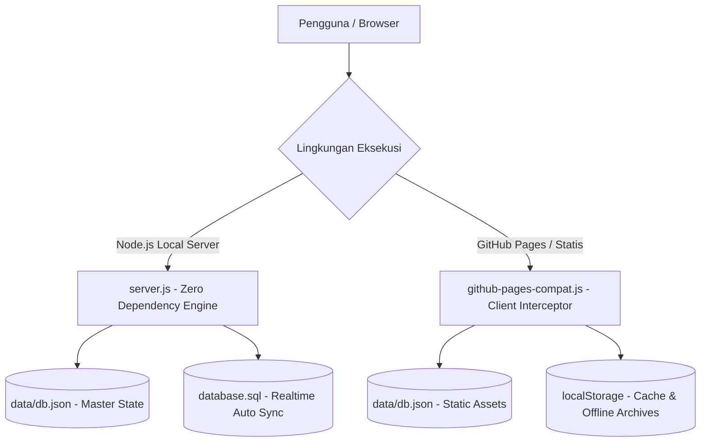

# DOKUMENTASI TEKNIK PEMBUATAN & ARSITEKTUR SISTEM
## SISTEM GENERATOR ADMINISTRASI UJIAN (ABSENSI & BERITA ACARA)
### SMK NEGERI 1 KLUNGKUNG

---

## 1. PENDAHULUAN & LATAR BELAKANG
Aplikasi ini dikembangkan untuk mendigitalkan, mempercepat, dan membakukan proses pembuatan dokumen administrasi Sumatif Akhir Semester (SAS) di **SMK Negeri 1 Klungkung**. Dokumen utama yang dihasilkan adalah:
1. **Daftar Hadir Peserta Ujian** (Lengkap dengan NIS, nomor urut, status kehadiran Hadir/Sakit/Izin/Alfa, serta tanda tangan pengawas).
2. **Berita Acara Penyelenggaraan Ujian** (Redaksi resmi terstandarisasi, rekap kehadiran otomatis tersinkron dari daftar hadir, catatan kendala, dan tanda tangan pengawas ujian).
3. **Arsip Dokumen Ujian** (Penyimpanan terpusat dokumen hasil cetak/unduh dengan riwayat lengkap, pencarian instan, dan 5 filter seleksi detail).

---

## 2. ARSITEKTUR SISTEM (DUAL ENVIRONMENT)
Sistem dirancang dengan arsitektur **Hybrid Zero-Dependency**:
1. **Mode Server Lokal / Intranet (Node.js Zero-Dependency)**:
   - Berjalan pada runtime Node.js bawaan tanpa memerlukan `node_modules` atau package manager eksternal.
   - Menggunakan modul inti: `http`, `fs`, `path`, `url`.
   - Menggunakan arsitektur REST API mandiri dan sinkronisasi realtime ke basis data relasional MySQL/MariaDB (`database.sql`).
2. **Mode Hosting Statis & GitHub Pages (Client-Side Interceptor)**:
   - Berkat file `assets/js/github-pages-compat.js`, seluruh sistem dapat dijalankan langsung di server hosting statis murni seperti **GitHub Pages** tanpa server Node.js.
   - Script kompatibilitas mencegat seluruh panggilan `/api/*` secara transparan dan mengalihkannya ke cache browser (`localStorage`) dan file master data statis `data/db.json`.



---

## 3. PEMISAHAN PANEL ADMINISTRATOR (MODULAR PER MENU)
Panel Administrator telah dipisahkan menjadi halaman HTML penuh independen (`1 Menu = 1 Full HTML Terkoneksi`), menghilangkan potensi kegagalan JS monolitik dan memungkinkan navigasi URL standar:

| Halaman | Lokasi Berkas | Deskripsi & Fungsi Utama |
|---|---|---|
| **Dashboard** | `public/admin/index.html` | Ringkasan statistik (menghitung Total Kelas Aktif yang memiliki siswa), status database, pintasan menu cepat. |
| **Siswa & Kelas** | `public/admin/siswa.html` | Master siswa & kelas dinamis, auto-register kelas baru saat input manual/impor Excel, export/import Excel (.xlsx), hapus siswa, dan hapus massal. |
| **Guru & Pengawas** | `public/admin/guru.html` | Master dewan guru & pengawas ujian, export/import Excel (.xlsx), autocomplete nama dan otomatisasi pengisian NIP, tombol **Hapus Data Guru**. |
| **Template Ujian** | `public/admin/template.html` | Redaksi HTML berita acara, variabel dinamis (`[semester]`, `[tahun_ajaran]`, `[tanggal]`, dll.), riwayat template, pratinjau live. |
| **Arsip Dokumen** | `public/admin/arsip.html` | Manajemen berkas ujian tersimpan dengan 5 filter seleksi detail, tinjau ulang berkas, unduh PDF, dan hapus berkas. |
| **Pengaturan Sekolah, Kelas & Kop** | `public/admin/pengaturan.html` | Identitas sekolah, upload & update **Logo Sekolah** resmi, upload/reset kop surat resmi, **Master Daftar Kelas** (dengan Export/Import Excel), **Master Daftar Mata Pelajaran** (dengan Export/Import Excel), dan Master Tahun Ajaran. |
| **Manajemen User** | `public/admin/users.html` | Kelola akun administrator & operator ujian, pengaturan kata sandi dengan toggle mata, proteksi akun utama. |
| **Database & Backup** | `public/admin/database.html` | Unduh langsung `database.sql`, `db.json`, `Data_Siswa.xlsx`, `Data_Guru.xlsx`, dan metrik kapasitas basis data. |
| **Login Administrator** | `public/admin/login.html` | Halaman login dengan tombol toggle mata pada kolom password, proteksi sesi (`sas_admin_auth`), dan multi-user authentication. |

---

## 4. STRUKTUR DIREKTORI PROYEK

```text
web-sas-dh-n-beritaacara/
├── index.html                   # Entry point root (auto-forwarding untuk GitHub Pages)
├── server.js                    # Web server HTTP mandiri Node.js (Zero Dependency)
├── database.sql                 # Skema DDL & DML MySQL/MariaDB (Auto-synchronized)
├── README.md                    # Panduan ringkas penggunaan sistem
├── Teknik pembuata.md           # Dokumentasi arsitektur, teknik, & alur pembuatan
├── package.json                 # Metadata proyek & skrip npm
├── data/
│   └── db.json                  # Basis data JSON utama (Master source of truth)
└── public/
    ├── index.html               # Beranda publik SMK Negeri 1 Klungkung
    ├── absensi.html             # Generator Daftar Hadir Ujian
    ├── berita-acara.html        # Generator Berita Acara Ujian
    ├── arsip.html               # Arsip Dokumen Publik (5 Filter Detail)
    ├── admin/                   # Modul Panel Administrator Terpisah
    │   ├── index.html           # Dashboard Admin (Total Kelas Aktif Berbasis Siswa)
    │   ├── siswa.html           # Master Siswa & Kelas (Auto-Register Kelas)
    │   ├── guru.html            # Master Guru & Pengawas (Tombol Hapus Data Guru)
    │   ├── template.html        # Template Ujian & Redaksi
    │   ├── arsip.html           # Arsip Dokumen Admin
    │   ├── pengaturan.html      # Pengaturan Sekolah, Logo, Kop, Kelas & Mapel (Export/Import .xlsx)
    │   ├── users.html           # Manajemen Akun User & Hak Akses
    │   ├── database.html        # Backup & Ekspor Basis Data
    │   └── login.html           # Login Admin (Password Eye Toggle)
    └── assets/
        ├── css/
        │   ├── app.css          # Desain sistem responsif & komponen UI
        │   └── preview-a4.css   # Styling cetak A4 presisi (Tanpa underline & tanda kurung pengawas)
        ├── js/
        │   ├── absensi.js       # Logika formulir & live preview absensi
        │   ├── berita-acara.js  # Logika formulir & live preview berita acara
        │   ├── admin-common.js  # Auth check, loader, sidebar active state, & toast helper
        │   ├── github-pages-compat.js # Client-side interceptor API untuk GitHub Pages
        │   ├── html2pdf.bundle.min.js # Kompilasi PDF berbasis canvas A4
        │   └── xlsx.full.min.js # SheetJS offline untuk export/import Excel
        └── img/
            ├── logo.png         # Logo resmi SMK Negeri 1 Klungkung
            ├── logo-default.png # Cadangan logo sekolah bawaan
            ├── kop-header.png   # Kop surat aktif
            └── kop-header-default.png # Cadangan kop surat bawaan pabrik
```

---

## 5. MEKANISME BASIS DATA & SINKRONISASI OTOMATIS
1. **JSON Primary Source of Truth (`data/db.json`)**:
   - Seluruh mutasi data (penambahan siswa, perubahan guru, update template, penggantian logo/kop, penambahan user, master kelas, dan penyimpanan arsip) diperbarui secara instan pada file `data/db.json`.
2. **Realtime SQL Synchronizer (`syncSqlFile`)**:
   - Fungsi `syncSqlFile(db)` di dalam `server.js` merekonstruksi seluruh skema relasional tabel MySQL/MariaDB:
     - `classes`
     - `students`
     - `teachers`
     - `exam_templates`
     - `settings`
     - `users`
     - `exam_archives`
   - Setiap kali terjadi perubahan pada REST API (POST `/api/save-db`, POST `/api/save-user`, POST `/api/save-archive`, POST `/api/upload-logo`, dll.), file `database.sql` ditulis ulang secara otomatis.

---

## 6. MEKANISME TOTAL KELAS AKTIF & REGISTRASI KELAS DINAMIS
1. **Total Kelas Aktif Realtime**:
   - Pada Dashboard (`/admin/index.html`) dan Backup (`/admin/database.html`), metrik "Total Kelas Aktif" dihitung dari kelas yang memiliki siswa terdaftar:
     ```javascript
     const activeClassIds = new Set((db.students || []).map(s => String(s.class_id)));
     const activeClasses = (db.classes || []).filter(c => activeClassIds.has(String(c.id)));
     ```
   - Ketika seluruh data siswa dikosongkan, Total Kelas Aktif otomatis bernilai **0**.
2. **Auto-Register Kelas Baru Saat Penginputan Siswa**:
   - Saat input manual di modal "Tambah Siswa Baru", pengguna dapat mengetik nama kelas baru (contoh: `XII DKV`) dan kelas tersebut otomatis terdaftar ke dalam tabel master kelas (`classes`).
   - Saat import Excel (.xlsx) data siswa, kolom `KELAS` dibaca dan seluruh kelas baru yang belum ada di database otomatis didaftarkan ke tabel `classes`.
3. **Master Daftar Kelas di Pengaturan**:
   - Pada menu **Pengaturan Sekolah & Kop**, administrator dapat mengelola kelas secara mandiri:
     - Tambah kelas manual (Nama Kelas, Tingkat, Program Keahlian).
     - **Export (.xlsx)** Master Kelas.
     - **Import (.xlsx)** Master Kelas dengan template standar.

---

## 7. FITUR EXPORT & IMPORT EXCEL (.XLSX)
Tersedia export dan import lembar kerja Microsoft Excel di seluruh modul utama:
1. **Master Siswa**: Export & Import via SheetJS (`/admin/siswa.html`).
2. **Master Guru & Pengawas**: Export & Import via SheetJS (`/admin/guru.html`).
3. **Master Daftar Kelas**: Export & Import via SheetJS (`/admin/pengaturan.html`).
4. **Master Mata Pelajaran Resmi**: Export & Import via SheetJS (`/admin/pengaturan.html`).

---

## 8. ANALISIS AUDIT KESELURUHAN & PENYELESAIAN MASALAH (BUG FIXES)

### A. Masalah: Data Siswa Tidak Muncul Saat Klik "Lihat Siswa" dari Dashboard
- **Gejala Masalah**:
  Setelah data siswa diimpor/diunggah dan terhitung di Dashboard, saat pengguna mengklik tombol **"Lihat Siswa"** pada kelas tertentu (`/admin/siswa.html?class_id=X`), tabel siswa tetap kosong atau macet pada tulisan *"Memuat data siswa..."*.
- **Akar Masalah (Root Cause)**:
  1. Pada fungsi `initSiswaPage()` di `siswa.html`, terdapat pemanggilan `document.getElementById('modal_class_id').innerHTML = ''`. Namun elemen `<select id="modal_class_id">` sebelumnya telah direfaktor menjadi input teks `<input id="modal_class_input">` dengan datalist. Hal ini menimbulkan eksepsi JavaScript fatal `TypeError: Cannot set properties of null (setting 'innerHTML')` yang memutus eksekusi sebelum fungsi render tabel siswa (`renderStudentsTable()`) dapat berjalan.
  2. Perbandingan tipe data ID: URL parameter `class_id` bertipe *string* (misal: `"1"`), sedangkan `s.class_id` dari JSON terkadang berupa *integer* (misal: `1`). Perbandingan ketat `===` tanpa konversi `String(...)` dapat menyebabkan pencarian kelas menghasilkan nilai kosong.
- **Solusi yang Diterapkan**:
  1. Membersihkan referensi elemen null pada `initSiswaPage()` dan mengarahkan opsi kelas ke elemen datalist yang valid (`modalClassesDatalist`).
  2. Membaca URL parameter `const initialClassId = new URLSearchParams(window.location.search).get('class_id')`, menyetel nilai `<select id="filterClassSelect"> = initialClassId`, lalu memanggil `onClassFilterChange()`.
  3. Memastikan perbandingan ID siswa dan kelas selalu menggunakan `String(s.class_id) === String(filterId)`.
  4. Menyelaraskan seluruh badge penghitung dan tabel pratinjau sehingga ketika tautan *"Lihat Siswa"* diklik, kelas terpilih langsung aktif dan seluruh siswa kelas tersebut langsung dirender dengan jumlah yang presisi.

### B. Interaktivitas Kartu Metrik Dashboard
- Kartu statistik metrik di Dashboard Admin (`public/admin/index.html`) kini berupa elemen interaktif (`<a>`) yang dapat diklik langsung:
  - *Total Kelas Aktif* ➔ Menuju ke Master Siswa & Kelas (`/admin/siswa.html`).
  - *Total Siswa Terdaftar* ➔ Menuju ke Master Data Siswa (`/admin/siswa.html`).
  - *Guru & Pengawas* ➔ Menuju ke Master Data Guru & Pengawas (`/admin/guru.html`).
  - *Template Ujian* ➔ Menuju ke Kelola Template & Redaksi Berita Acara (`/admin/template.html`).
  - *Dokumen Diarsipkan* ➔ Menuju ke Arsip Dokumen Ujian (`/admin/arsip.html`).
  - *User Administrator* ➔ Menuju ke Manajemen User (`/admin/users.html`).

### C. Konsistensi Bahasa & Alur Antar Menu
- Seluruh istilah telah diseragamkan dengan standar tata kelola ujian resmi Indonesia:
  - Satuan pendidikan: **SMK NEGERI 1 KLUNGKUNG**.
  - Waktu pelaksanaan: Menggunakan zona waktu **WITA** (Waktu Indonesia Tengah).
  - Tanda tangan pengawas: Bersih tanpa kurung `()` dan tanpa garis bawah (*underline*).
  - Sinkronisasi Berita Acara & Daftar Hadir: Rekap peserta otomatis terisi berdasarkan Tanggal Ujian dan Mata Pelajaran yang cocok dari Daftar Hadir.
  - Dropdown kelas pada formulir publik (`absensi.html` & `berita-acara.html`): Jika basis data kelas masih kosong, sistem secara elegan menampilkan opsi *"-- Belum Ada Kelas Terdaftar --"* dan tidak mengalami macet/loading tanpa henti.

---

## 9. PANDUAN PENGGUNAAN & RUNNING LOKAL

### Menjalankan dengan Node.js Lokal:
```bash
# Jalankan server lokal
node server.js
```
Buka browser pada alamat: `http://localhost:3000`

### Menjalankan di GitHub Pages:
1. Pastikan kode ter-upload di repository GitHub (`https://github.com/01dell18-gif/web-sas-dh-n-beritaacara`).
2. Masuk ke tab **Settings** > **Pages** di repository GitHub Anda.
3. Pada bagian **Build and deployment**, pilih:
   - **Source**: `Deploy from a branch`
   - **Branch**: `main` / `(root)`
4. Klik **Save**. Dalam beberapa menit situs akan aktif pada URL:
   `https://01dell18-gif.github.io/web-sas-dh-n-beritaacara/`
5. Aplikasi akan langsung berfungsi penuh berkat modul `assets/js/github-pages-compat.js`.
