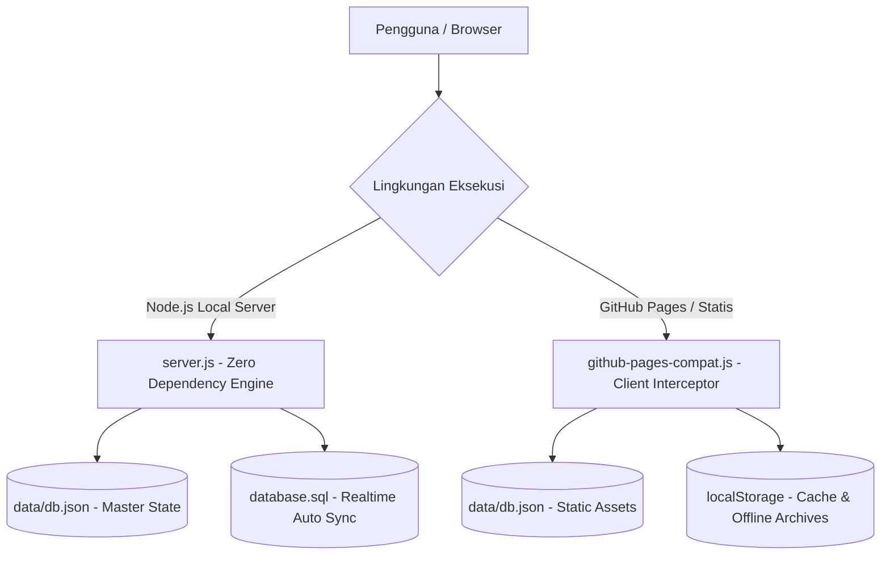

# DOKUMENTASI TEKNIK PEMBUATAN & ARSITEKTUR SISTEM

## SISTEM GENERATOR ADMINISTRASI UJIAN (ABSENSI & BERITA ACARA)

### SMK NEGERI 1 KLUNGKUNG

---

## 1. PENDAHULUAN & LATAR BELAKANG

Aplikasi ini dikembangkan untuk mendigitalkan, mempercepat, dan membakukan proses pembuatan dokumen administrasi Sumatif Akhir Semester (SAS) di **SMK Negeri 1 Klungkung**. Dokumen utama yang dihasilkan adalah:

1. **Daftar Hadir Peserta Ujian** (Lengkap dengan NIS, nomor urut, status kehadiran Hadir/Sakit/Izin/Alfa, serta tanda tangan pengawas).
2. **Berita Acara Penyelenggaraan Ujian** (Redaksi resmi terstandarisasi, rekap kehadiran otomatis tersinkron dari daftar hadir, catatan kendala, dan tanda tangan pengawas ujian).
3. **Arsip Dokumen Ujian** (Penyimpanan terpusat dokumen hasil cetak/unduh dengan riwayat lengkap, pencarian instan, dan 5 filter seleksi detail).

---

## 2. ARSITEKTUR SISTEM (DUAL ENVIRONMENT)

Sistem dirancang dengan arsitektur **Hybrid Zero-Dependency**:

1. **Mode Server Lokal / Intranet (Node.js Zero-Dependency)**:
   - Berjalan pada runtime Node.js bawaan tanpa memerlukan `node_modules` atau package manager eksternal.
   - Menggunakan modul inti: `http`, `fs`, `path`, `url`.
   - Menggunakan arsitektur REST API mandiri dan sinkronisasi realtime ke basis data relasional MySQL/MariaDB (`database.sql`).
2. **Mode Hosting Statis & GitHub Pages (Client-Side Interceptor)**:
   - Berkat file `assets/js/github-pages-compat.js`, seluruh sistem dapat dijalankan langsung di server hosting statis murni seperti **GitHub Pages** tanpa server Node.js.
   - Script kompatibilitas mencegat seluruh panggilan `/api/*` secara transparan dan mengalihkannya ke cache browser (`localStorage`) dan file master data statis `data/db.json`.



---

## 3. PEMISAHAN PANEL ADMINISTRATOR (MODULAR PER MENU)

Panel Administrator telah dipisahkan menjadi halaman HTML penuh independen (`1 Menu = 1 Full HTML Terkoneksi`), menghilangkan potensi kegagalan JS monolitik dan memungkinkan navigasi URL standar:

| Halaman | Lokasi Berkas | Deskripsi & Fungsi Utama |
| --- | --- | --- |
| **Dashboard** | `public/admin/index.html` | Ringkasan statistik (menghitung Total Kelas Aktif yang memiliki siswa), status database, pintasan menu cepat. |
| **Siswa & Kelas** | `public/admin/siswa.html` | Master siswa & kelas dinamis, kolom Program Keahlian, auto-register kelas baru saat input manual/impor Excel, export seluruh data siswa (.xlsx), paginasi limit data (20-500, semua), hapus siswa, dan hapus massal. |
| **Guru & Pengawas** | `public/admin/guru.html` | Master dewan guru & pengawas ujian, export seluruh data guru (.xlsx), paginasi limit data, autocomplete nama dan otomatisasi pengisian NIP, tombol **Hapus Data Guru**. |
| **Template Ujian** | `public/admin/template.html` | Redaksi HTML berita acara, variabel dinamis (`[semester]`, `[tahun_ajaran]`, `[tanggal]`, dll.), riwayat template, pratinjau live. |
| **Arsip Dokumen** | `public/admin/arsip.html` | Manajemen berkas ujian tersimpan dengan filter horizontal mendatar ke samping (5 filter seleksi detail), tinjau ulang berkas, unduh PDF, dan hapus berkas. |
| **Pengaturan Sekolah, Kelas & Kop** | `public/admin/pengaturan.html` | Identitas sekolah, upload & update **Logo Sekolah** resmi, upload/reset kop surat resmi, **Master Daftar Kelas** (dengan Export/Import Excel & cascade update ke siswa), **Master Daftar Mata Pelajaran** (dengan Export/Import Excel), dan Master Tahun Ajaran. |
| **Manajemen User** | `public/admin/users.html` | Kelola akun administrator & operator ujian, kolom password dengan toggle mata, input nama terintegrasi autocomplete Master Guru, proteksi akun utama. |
| **Database & Backup** | `public/admin/database.html` | Unduh langsung `database.sql`, `db.json`, `Data_Siswa.xlsx` (lengkap nama, kelas, tingkat, program keahlian), `Data_Guru.xlsx` (lengkap NIP, nama, mapel, jabatan), dan metrik kapasitas basis data. |
| **Login Administrator** | `public/admin/login.html` | Halaman login dengan tombol toggle mata pada kolom password, proteksi sesi (`sas_admin_auth`), dan multi-user authentication. |

---

## 4. STRUKTUR DIREKTORI PROYEK

```text
web-sas-dh-n-beritaacara/
├── index.html                   # Entry point root (auto-forwarding untuk GitHub Pages)
├── server.js                    # Web server HTTP mandiri Node.js (Zero Dependency)
├── database.sql                 # Skema DDL & DML MySQL/MariaDB (Auto-synchronized)
├── README.md                    # Panduan ringkas penggunaan sistem
├── Teknik pembuata.md           # Dokumentasi arsitektur, teknik, & alur pembuatan
├── package.json                 # Metadata proyek & skrip npm
├── data/
│   └── db.json                  # Basis data JSON utama (Master source of truth)
└── public/
    ├── index.html               # Beranda publik SMK Negeri 1 Klungkung
    ├── absensi.html             # Generator Daftar Hadir Ujian
    ├── berita-acara.html        # Generator Berita Acara Ujian
    ├── arsip.html               # Arsip Dokumen Publik (Filter Horizontal Mendatar)
    ├── admin/                   # Modul Panel Administrator Terpisah
    │   ├── index.html           # Dashboard Admin (Total Kelas Aktif Berbasis Siswa)
    │   ├── siswa.html           # Master Siswa & Kelas (Kolom Program Keahlian, Paginasi, Export Lengkap)
    │   ├── guru.html            # Master Guru & Pengawas (Paginasi, Export Lengkap, Hapus Data Guru)
    │   ├── template.html        # Template Ujian & Redaksi
    │   ├── arsip.html           # Arsip Dokumen Admin (Filter Horizontal Mendatar)
    │   ├── pengaturan.html      # Pengaturan Sekolah, Logo, Kop, Kelas & Mapel (Export/Import .xlsx)
    │   ├── users.html           # Manajemen Akun User (Password Eye Toggle & Master Guru Datalist)
    │   ├── database.html        # Backup & Ekspor Basis Data (Download Lengkap Siswa & Guru)
    │   └── login.html           # Login Admin (Password Eye Toggle)
    └── assets/
        ├── css/
        │   ├── app.css          # Desain sistem responsif & komponen UI
        │   └── preview-a4.css   # Styling cetak A4 presisi (Tanpa underline & tanda kurung pengawas)
        ├── js/
        │   ├── absensi.js       # Logika formulir & live preview absensi
        │   ├── berita-acara.js  # Logika formulir & live preview berita acara
        │   ├── admin-common.js  # Auth check, loader, sidebar active state, & toast helper
        │   ├── github-pages-compat.js # Client-side interceptor API untuk GitHub Pages
        │   ├── html2pdf.bundle.min.js # Kompilasi PDF berbasis canvas A4
        │   └── xlsx.full.min.js # SheetJS offline untuk export/import Excel
        └── img/
            ├── logo.png         # Logo resmi SMK Negeri 1 Klungkung
            ├── logo-default.png # Cadangan logo sekolah bawaan
            ├── kop-header.png   # Kop surat aktif
            └── kop-header-default.png # Cadangan kop surat bawaan pabrik
```

---

## 5. MEKANISME BASIS DATA & SINKRONISASI OTOMATIS

1. **JSON Primary Source of Truth (`data/db.json`)**:
   - Seluruh mutasi data (penambahan siswa, perubahan guru, update template, penggantian logo/kop, penambahan user, master kelas, dan penyimpanan arsip) diperbarui secara instan pada file `data/db.json`.

2. **Realtime SQL Synchronizer (`syncSqlFile`)**:
   - Fungsi `syncSqlFile(db)` di dalam `server.js` merekonstruksi seluruh skema relasional tabel MySQL/MariaDB:
     - `classes`
     - `students`
     - `teachers`
     - `exam_templates`
     - `settings`
     - `users`
     - `exam_archives`
   - Setiap kali terjadi perubahan pada REST API (POST `/api/save-db`, POST `/api/save-user`, POST `/api/save-archive`, POST `/api/upload-logo`, dll.), file `database.sql` dan `public/database.sql` ditulis ulang secara otomatis.

---

## 6. SINKRONISASI MASTER KELAS, SISWA & PENGAWAS

1. **Total Kelas Aktif Berbasis Siswa**:
   - Pada Dashboard, indikator Total Kelas Aktif hanya menghitung kelas yang memiliki siswa terdaftar.
2. **Auto-Register Kelas Baru**:
   - Saat input manual siswa baru, jika kelas yang diketik belum ada di database, sistem mendaftarkan kelas tersebut secara otomatis dengan Program Keahlian yang terdeteksi cerdas.
   - Saat import Excel (.xlsx) data siswa, kolom `KELAS` dibaca dan seluruh kelas baru yang belum ada di database otomatis didaftarkan ke tabel `classes`.
3. **Master Daftar Kelas di Pengaturan**:
   - Administrator dapat mengelola kelas secara mandiri:
     - Tambah kelas manual (Nama Kelas, Tingkat, Program Keahlian).
     - **Export (.xlsx)** Master Kelas.
     - **Import (.xlsx)** Master Kelas dengan template standar.
     - **Cascade Update Relasional**: Edit nama kelas otomatis menyelaraskan seluruh data siswa dan arsip yang berelasi.

---

## 7. FITUR EXPORT & IMPORT EXCEL (.XLSX) MENYELURUH

Tersedia export dan import lembar kerja Microsoft Excel di seluruh modul utama:

1. **Master Siswa**: Export seluruh data siswa dari database dengan kolom `NO`, `NIS`, `NAMA`, `KELAS`, `TINGKAT`, dan `PROGRAM_KEAHLIAN` (`/admin/siswa.html`).
2. **Master Guru & Pengawas**: Export seluruh data guru dari database dengan kolom `NO`, `NIP`, `NAMA`, `MAPEL`, dan `JABATAN` (`/admin/guru.html`).
3. **Master Daftar Kelas**: Export seluruh data kelas dengan kolom `NO`, `NAMA_KELAS`, `TINGKAT`, `PROGRAM_KEAHLIAN`, dan `JUMLAH_SISWA` (`/admin/pengaturan.html`).
4. **Master Mata Pelajaran Resmi**: Export seluruh daftar mata pelajaran dengan kolom `NO` dan `MATA_PELAJARAN` (`/admin/pengaturan.html`).
5. **Menu Backup & Database SQL**: Unduh `Data_Siswa.xlsx` dan `Data_Guru.xlsx` lengkap dan akurat 100% sesuai skema relasional database.

---

## 8. ANALISIS AUDIT KESELURUHAN & PENYELESAIAN MASALAH (BUG FIXES)

### A. Masalah: Data Siswa Tidak Muncul Saat Klik "Lihat Siswa" dari Dashboard

- **Gejala Masalah**:
  Setelah data siswa diimpor/diunggah dan terhitung di Dashboard, saat pengguna mengklik tombol **"Lihat Siswa"** pada kelas tertentu (`/admin/siswa.html?class_id=X`), tabel siswa tetap kosong atau macet pada tulisan *"Memuat data siswa..."*.
- **Akar Masalah (Root Cause)**:
  1. Pada fungsi `initSiswaPage()` di `siswa.html`, terdapat pemanggilan `document.getElementById('modal_class_id').innerHTML = ''`. Namun elemen `<select id="modal_class_id">` sebelumnya telah direfaktor menjadi input teks `<input id="modal_class_input">` dengan datalist. Hal ini menimbulkan eksepsi JavaScript fatal `TypeError: Cannot set properties of null (setting 'innerHTML')` yang memutus eksekusi sebelum fungsi render tabel siswa (`renderStudentsTable()`) dapat berjalan.
  2. Perbandingan tipe data ID: URL parameter `class_id` bertipe *string* (misal: `"1"`), sedangkan `s.class_id` dari JSON terkadang berupa *integer* (misal: `1`). Perbandingan ketat `===` tanpa konversi `String(...)` dapat menyebabkan pencarian kelas menghasilkan nilai kosong.
- **Solusi yang Diterapkan**:
  1. Membersihkan referensi elemen null pada `initSiswaPage()` dan mengarahkan opsi kelas ke elemen datalist yang valid (`modalClassesDatalist`).
  2. Membaca URL parameter `const initialClassId = new URLSearchParams(window.location.search).get('class_id')`, menyetel nilai `<select id="filterClassSelect"> = initialClassId`, lalu memanggil `onClassFilterChange()`.
  3. Memastikan perbandingan ID siswa dan kelas selalu menggunakan `String(s.class_id) === String(filterId)`.
  4. Menyelaraskan seluruh badge penghitung dan tabel pratinjau sehingga ketika tautan *"Lihat Siswa"* diklik, kelas terpilih langsung aktif dan seluruh siswa kelas tersebut langsung dirender dengan jumlah yang presisi.

### B. Interaktivitas Kartu Metrik Dashboard

Kartu statistik metrik di Dashboard Admin (`public/admin/index.html`) berupa elemen interaktif (`<a>`) yang dapat diklik langsung:

- *Total Kelas Aktif* ➔ Menuju ke Master Siswa & Kelas (`/admin/siswa.html`).
- *Total Siswa Terdaftar* ➔ Menuju ke Master Data Siswa (`/admin/siswa.html`).
- *Guru & Pengawas* ➔ Menuju ke Master Data Guru & Pengawas (`/admin/guru.html`).
- *Template Ujian* ➔ Menuju ke Kelola Template & Redaksi Berita Acara (`/admin/template.html`).
- *Dokumen Diarsipkan* ➔ Menuju ke Arsip Dokumen Ujian (`/admin/arsip.html`).
- *User Administrator* ➔ Menuju ke Manajemen User (`/admin/users.html`).

### C. Konsistensi Bahasa & Alur Antar Menu

Seluruh istilah telah diseragamkan dengan standar tata kelola ujian resmi Indonesia:

- Satuan pendidikan: **SMK NEGERI 1 KLUNGKUNG**.
- Waktu pelaksanaan: Menggunakan zona waktu **WITA** (Waktu Indonesia Tengah).
- Tanda tangan pengawas: Bersih tanpa kurung `()` dan tanpa garis bawah (*underline*).
- Sinkronisasi Berita Acara & Daftar Hadir: Rekap peserta otomatis terisi berdasarkan Tanggal Ujian dan Mata Pelajaran yang cocok dari Daftar Hadir.
- Dropdown kelas pada formulir publik (`absensi.html` & `berita-acara.html`): Jika basis data kelas masih kosong, sistem secara elegan menampilkan opsi *"-- Belum Ada Kelas Terdaftar --"* dan tidak mengalami macet/loading tanpa henti.

---

## 9. PANDUAN PENGGUNAAN & RUNNING LOKAL

### Menjalankan dengan Node.js Lokal

```bash
# Jalankan server lokal
node server.js
```

Buka browser pada alamat: `http://localhost:3000`

### Menjalankan di GitHub Pages

1. Pastikan kode ter-upload di repository GitHub (`https://github.com/01dell18-gif/web-sas-dh-n-beritaacara`).
2. Masuk ke tab **Settings** > **Pages** di repository GitHub Anda.
3. Pada bagian **Build and deployment**, pilih:
   - **Source**: `Deploy from a branch`
   - **Branch**: `main` / `(root)`
4. Klik **Save**. Dalam beberapa menit situs akan aktif pada URL:
   `https://01dell18-gif.github.io/web-sas-dh-n-beritaacara/`
5. Aplikasi akan langsung berfungsi penuh berkat modul `assets/js/github-pages-compat.js`.

---

## 10. PEMBARUAN FITUR & OPTIMASI TERBARU (UPDATE v2.7)

### 1. Tampilan Program / Konsentrasi Keahlian di Master Data Siswa & Master Kelas
- Pada halaman **Master Data Siswa & Master Kelas** (`public/admin/siswa.html`), kolom **Program / Konsentrasi Keahlian** kini ditampilkan secara langsung dalam tabel data siswa dengan badge yang elegan.
- Opsi pilihan kelas pada filter dropdown juga menyertakan nama Program Keahlian resmi dari kelas terkait.

### 2. Ekspor Menyeluruh (Export All Records) pada Semua Tombol Export
- Seluruh tombol export (.xlsx) pada:
  - Master Siswa (`/admin/siswa.html`)
  - Master Guru & Pengawas (`/admin/guru.html`)
  - Master Kelas (`/admin/pengaturan.html`)
  - Master Mata Pelajaran (`/admin/pengaturan.html`)
  - Menu Backup Database (`/admin/database.html`)
- Kini secara konsisten mengekspor **seluruh data yang ada di database**, terlepas dari halaman aktif paginasi atau filter seleksi sementara, sehingga berkas unduhan selalu utuh dan lengkap.

### 3. Perbaikan Unduh Data_Siswa.xlsx dan Data_Guru.xlsx di Menu Backup Database
- Pada menu **Backup & Database SQL** (`public/admin/database.html`):
  - Tombol **Unduh Data_Siswa.xlsx** telah diperbaiki dari properti lama yang tidak sesuai menjadi referensi relasional database yang presisi: `NIS`, `Nama Lengkap Peserta Didik`, `Kelas`, `Tingkat`, dan `Program / Konsentrasi Keahlian`.
  - Tombol **Unduh Data_Guru.xlsx** kini mengekspor seluruh data guru dan pengawas lengkap dengan: `NIP`, `Nama Lengkap & Gelar`, `Mata Pelajaran Diampu`, dan `Jabatan / Peran`.

### 4. Filter Horizontal Mendatar ke Samping pada Arsip Dokumen
- Tata letak filter detail dokumen di halaman publik (`public/arsip.html`) dan admin (`public/admin/arsip.html`) disusun **mendatar ke samping (horizontal)** dengan `overflow-x: auto`, menghemat ruang vertikal dan mempermudah pemilihan filter.

### 5. Standarisasi Program / Konsentrasi Keahlian SMK N 1 Klungkung
- Menggantikan label generic "Umum" dengan konsentrasi keahlian resmi SMK Negeri 1 Klungkung:
  - **XII TKJ**: Teknik Komputer dan Jaringan
  - **XII DKV**: Desain Komunikasi Visual
  - **XII LPKKK 1 & 2**: Layanan Penunjang Kefarmasian Klinis dan Komunitas
  - **XII BD 1 & 2**: Bisnis Digital
  - **XII MP 1 & 2**: Manajemen Perkantoran dan Layanan Bisnis
  - **XII LPB**: Layanan Perbankan
  - **XII AK**: Akuntansi dan Keuangan Lembaga
  - **XII TSM**: Teknik Sepeda Motor
- Dilengkapi fungsi deteksi otomatis cerdas `detectProgramKeahlian(className)` saat input siswa manual maupun saat import file Excel.

### 6. Penyelarasan Berantai Relasi Kelas (Cascade Update Relasional)
- Pada menu **Master Daftar Kelas Resmi** (`public/admin/pengaturan.html`), ketika administrator mengedit atau memperbarui data kelas (Nama Kelas, Tingkat, Program Keahlian), seluruh data siswa (`db.students`) dan arsip yang berelasi otomatis diselaraskan secara realtime ke `data/db.json` serta `database.sql`.

### 7. Paginasi Fleksibel & Limit Baris Data
- Pada Master Siswa dan Master Guru, disediakan pemilih limit data: **20, 40, 50, 100, 200, 400, 500 data**, dan **Semua data**, lengkap dengan tombol Sebelumnya/Setelahnya dan penomoran urut berkesinambungan.

### 8. Manajemen User: Integrasi Master Guru & Toggle Password Mata
- Pada menu **Manajemen User & Hak Akses** (`public/admin/users.html`), tabel pengguna memiliki kolom Password dengan tombol toggle mata (`bi-eye`), dan input Nama Lengkap Pengguna terintegrasi dengan Master Data Guru via `<datalist>`.

---

## 11. PEMBARUAN FITUR & OPTIMASI TERBARU (UPDATE v2.8)

### 1. Pembatasan Hak Akses Peran Operator (Role-Based Access Control)
- Pengguna dengan peran **Operator** (`role: 'operator'`) kini dibatasi hak aksesnya:
  - Menu **Manajemen User** dan **Backup & Database SQL** disembunyikan secara otomatis dari bilah navigasi sidebar di seluruh halaman admin.
  - Kartu metrik dan tombol pintasan Manajemen User di Dashboard Admin disembunyikan khusus untuk peran Operator.
  - Dilengkapi sistem proteksi routing langsung (*guard*); jika akun Operator mencoba membuka URL `/admin/users.html` atau `/admin/database.html` secara manual, sistem langsung menolak akses dan mengarahkannya kembali ke Dashboard Admin.

### 2. Tombol Perbarui Pengaturan di Paling Bawah Halaman
- Tombol **"Perbarui Pengaturan, Logo & Kop Surat"** pada menu **Pengaturan Sekolah & Kop** (`public/admin/pengaturan.html`) dipindahkan ke posisi paling bawah halaman (setelah kartu Master Daftar Tahun Ajaran).
- Berfungsi menyimpan seluruh perubahan konfigurasi sekaligus ke basis data: nama sekolah, tagline, zona waktu, tahun ajaran aktif, berkas logo baru (base64/file), berkas kop surat resmi baru, daftar kelas resmi, mata pelajaran, dan tahun ajaran.

### 3. Deteksi Perubahan Belum Disimpan & Konfirmasi Buka Menu Baru
- Dilengkapi mekanisme *dirty state tracking* (`isDirty`) yang memantau perubahan pada input teks, dropdown, berkas logo, berkas kop surat, daftar kelas, mata pelajaran, dan tahun ajaran.
- Disertai lencana status dinamis (*"Belum Ada Perubahan"* vs *"Ada Perubahan Belum Disimpan"*).
- Jika pengguna telah mengubah data namun belum menekan tombol simpan di bagian bawah, lalu mengeklik menu navigasi lain (atau tombol kembali/keluar), sistem menampilkan modal konfirmasi dengan 3 pilihan:
  - **Simpan & Lanjutkan**: Menyimpan seluruh perubahan ke basis data lalu melanjutkan ke menu yang dipilih.
  - **Abaikan & Lanjutkan**: Mengabaikan perubahan yang belum disimpan dan langsung membuka menu tujuan.
  - **Batal**: Menutup modal dan tetap berada di halaman pengaturan untuk melanjutkan penyesuaian.
- Dilengkapi proteksi `beforeunload` bawaan browser untuk mencegah hilangnya data saat tab ditutup atau direfresh tanpa sengaja.

### 4. Konfirmasi Dialog Saat Keluar dari Panel Admin (Logout Guard)
- Seluruh tombol **Keluar** pada panel administrator kini dilengkapi dialog konfirmasi (*"Apakah Anda yakin ingin keluar dari Panel Administrator?"*), mencegah pengguna keluar secara tidak sengaja saat sedang bekerja.
